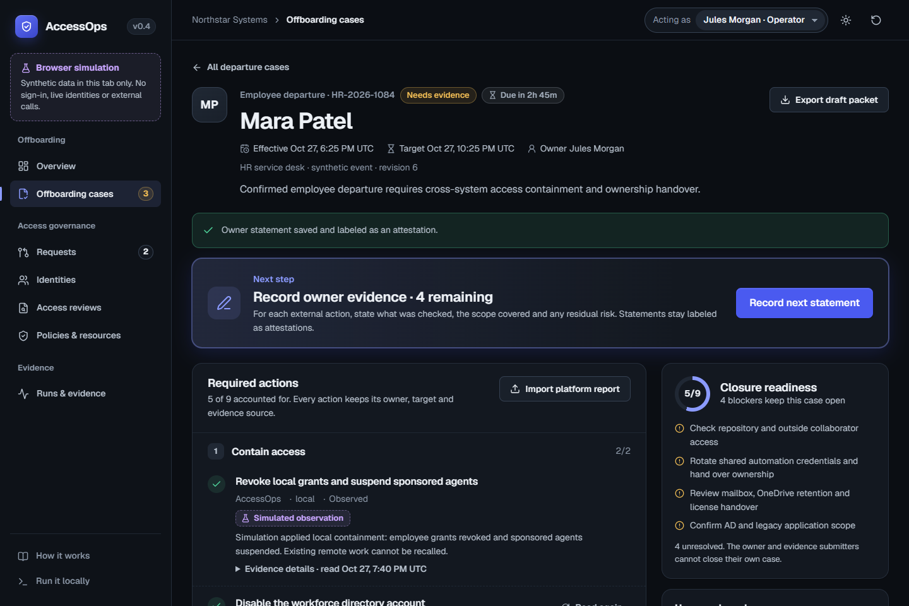

# AccessOps

**Disabling a leaver's account doesn't end their access. AccessOps ends the access it can reach, reads each system back to confirm it, and gives the rest an owner.**

When an employee or contractor leaves, their sessions, tokens, group rights and
Kerberos tickets can outlive the disabled account. AccessOps starts from a
signed HR event: it opens a departure case, ends access in Keycloak, a Microsoft
Entra ID test tenant and an Active Directory-compatible directory, suspends the
automated agents the person sponsors, and reads each of those systems back
before the work counts.
What it can't reach (GitHub, shared credentials, Microsoft 365 handover and
legacy apps) stays open as owned work with a four-hour target. The case closes
only when someone other than its owner accepts the exact evidence packet.

[Live demo](https://aman-agarwal6.github.io/AccessOps/) ·
[Case study](https://aman-agarwal6.github.io/projects/accessops.html) ·
[Verification ledger](docs/verification.md) ·
[The departure problem](docs/enterprise-application.md) ·
[Releases](https://github.com/aman-agarwal6/AccessOps/releases)



## What it shows

Measured with synthetic users on a local lab with real Keycloak 26.8, OPA,
PostgreSQL and a Samba directory, and in a free Microsoft Entra test tenant:

- **A signed HR event ends access in 2.6 seconds.** The case opens, the account
  is disabled, every Keycloak session ends, the person is signed out of an app,
  and that app refuses their still-unexpired access token.
- **Microsoft Entra containment runs against a real test tenant.** Through
  Microsoft Graph, AccessOps disables the account, removes its group membership
  and revokes its sign-in sessions, and the case counts it only after Graph
  reads all three back.
- **Disabled is not done.** Live before-and-after checks found six gaps that
  disabling an account leaves open or key handling exposes. Each one is fixed
  or stated on the case (below).
- **Access after departure is caught.** A Keycloak sign-in after the departure
  is detected 32 seconds after it happened, blocks closure, and becomes a signed
  Shared Signals event for the SOC. In a separate run,
  [SignalBridge](https://github.com/aman-agarwal6/signalbridge) polled the
  signed events and opened a case from the sign-in
  ([receipt](https://github.com/aman-agarwal6/signalbridge/blob/main/docs/evidence/20261005-accessops-leaver-poll-931402fb1ee44209b58c60063f63150f.json)).
- **The people who can disable anyone need a second factor**, enforced by the
  identity provider and again by the backend, including against a request
  rewritten to ask for less.
- **Signing keys are rotated live in both Keycloak realms**, and a leaked key
  is rehearsed in the workforce realm.
- **The directory's limits are measured, not assumed.** Kerberos tickets issued
  before offboarding keep working for up to 10 hours, and the case says so.

## What the live runs caught

I found each of these on the live lab. Group membership and both key gaps
showed up as failed runs; the [ledger](docs/verification.md) records each one
beside its fix. For sessions and tokens I compared disabling the account alone
with full containment, and a directory probe measured held connections and
Kerberos tickets.

| What survived | Before the fix | Now |
| --- | --- | --- |
| Group membership | Disabling the account left a managed group membership behind | Offboarding removes every known managed grant and needs a fresh negative reading for each |
| Signed-in sessions | New tokens stopped, but the person stayed signed in to the app and Keycloak kept the session | Containment ends Keycloak sessions and sends back-channel logout; it counts as done only when no session is left |
| Tokens an app checks itself | The app kept accepting the leaver's token for up to two more minutes | Each app gets its own stream of signed revocation events; the lab app refuses the token 3 seconds after containment |
| A leaked signing key | Keycloak's own introspection accepted a token forged with the published key; apps cached Keycloak's keys for five minutes, so a removed key could stay trusted that long | Removing a leaked key is the only remedy, so apps drop removed keys within 60 seconds |
| Key rotation | Switching to a new signing key at once made the app refuse valid tokens for 30 seconds | Rotation publishes the new key first and waits one key-cache lifetime; no valid token is refused |
| Kerberos tickets | Connections and tickets from before offboarding kept the removed group's rights | Kerberos has no per-user revocation; new tickets are refused and the case states when the old ones expire |

## Try it

The demo runs entirely in your browser with synthetic data. No sign-in, live
identities or external calls. It walks through one departure case. My live lab
results are on its **Runs & evidence** page as recorded reports.

1. On the overview, click **Work Mara's departure**.
2. Click **Apply local containment**. Her grants are revoked and her sponsored
   agent is suspended.
3. Click **Import platform report**, then **Load after-departure fixture** and
   **Assess & import report**. Entra sign-in clears as an imported snapshot;
   GitHub stays unresolved because absence from a list is not proof.
4. Click **Record next statement** for each of the six remaining actions and
   save each with **Save owner attestation**.
5. Click **Act as Avery Chen** (an independent reviewer), then
   **Review & close case** and **Accept evidence & close case**. Then
   **Export closure packet**.

The queue also holds an overdue contractor, a scheduled departure and a closed
historical case. Switch roles with **Acting as** in the top bar to see each
boundary explained.

## What is real and what is simulated

Every action carries one of these labels, and a label never upgrades itself.

| Evidence | Meaning |
| --- | --- |
| Signed CI evidence | Release bytes bound to the public workflow and source commit by a Sigstore attestation |
| Provider observation | Read back from the lab's real Keycloak, Samba directory or Microsoft Entra test tenant after the change |
| Imported snapshot | A bounded report someone supplied; point-in-time and untrusted |
| Owner attestation | A written statement by the case owner, reviewed at closure, never treated as proof |
| Simulated | Produced by the browser demo; nothing outside the tab was contacted |

## Verified results

Local lab runs on 5 October 2026 with synthetic records, on the current backend
source. Details, every failed attempt and the limits of each check are in the
[verification ledger](docs/verification.md).

| Check | Result |
| --- | --- |
| Signed HR event → case, containment, sessions ended, app signed out, token refused | 10 / 10 passed: 2.6 s, or 2.3 s after a future-dated departure takes effect |
| Leaver's sessions and tokens before → after containment | 22 / 22 passed: back-channel logout; refresh, offline and introspection rejected; a locally checked token refused 3.0 s after containment |
| Sign-in after departure detected, blocking closure, signalled to the SOC | 7 / 7 passed: detected 32 s after the sign-in. The suite itself acted as the SOC receiver; SignalBridge consumed the signals of a separate run (04:35 UTC, see the ledger) |
| Operator sign-in with a second factor | 3 / 3 MFA checks passed, within the 14 / 14 sign-in suite: a password alone stops at the code form, a wrong code is refused, and a request lowered to password-only gets no session |
| Signing-key rotation (both realms) and leaked-key drill (workforce realm) | 13 / 13 passed: no token refused during rotation; a forged token refused by Keycloak at once and by the app 60 s after the key's removal |
| Live Microsoft Entra departure (a free test tenant, synthetic users) | 11 / 11 passed: Graph showed the account disabled, out of the group and sessions revoked 19.8 s after containment; the tenant administrator and an unlisted user were refused |
| Departure case end to end through real Keycloak | 18 / 18 passed |
| Departure case with a Samba directory account | 28 / 28 passed; new LDAPS and Kerberos logins allowed → denied (2 / 2 each) |
| Directory sessions and tickets held from before offboarding | 6 / 6 passed: no new service tickets; earlier ones keep working until they expire (10 h) |
| Full lab suite (`Test-Lab.ps1`) | All passed: policy 32, protocols 18, sign-in 14, offboarding 11, cases 18, sessions 22, HR 10, assurance 7, HTTPS 5 |
| Console in real Firefox against the lab | Full departure case passed, with one-time codes |
| Signed [v0.4.0 release](https://github.com/aman-agarwal6/AccessOps/releases/tag/v0.4.0) (GitHub CI) | 401 / 401 backend and integration test cases (217 test functions, some run with several inputs) on PostgreSQL 17; provenance and SBOM attestations verified |
| Deployed demo | 17 / 17 checks passed |

Live suite counts include setup and cleanup steps, such as operator sign-in,
sign-out and restoring the test user.

## How it is built

- **Console:** React, TypeScript and Vite, with Radix dialogs. Dark and light
  themes from one token set, a 16px type scale, keyboard-first navigation.
- **Backend:** Django and PostgreSQL. Server sessions with OIDC code flow and
  PKCE; no tokens in the browser. Every change made with the session cookie
  needs a CSRF token. Machine endpoints skip the cookie and check their own
  credential: a webhook signature for HR events, a receiver token for the
  Shared Signals poll, a signed logout token for back-channel logout, and an
  introspected executor token for assistant tool calls.
- **Identity and policy:** Keycloak keeps operator login (with a second factor)
  separate from workforce provisioning (SCIM). Every action is checked by OPA
  through an AuthZEN request, and policy failure denies.
- **Execution:** a durable outbox applies remote changes, reads before retrying
  and records actual observation times.
- **Signals:** a Shared Signals transmitter (SSF 1.0, CAEP, RISC) with a
  separate poll stream (RFC 8936) per receiver: the SOC, and apps that check
  tokens themselves.
- **Directory:** LDAPS with verified TLS, immutable GUID targets, atomic account
  flag updates and permissions limited to the exact fixture objects.
- **Microsoft Entra (test tenant):** Microsoft Graph with certificate client
  credentials. The connector acts only on the users and groups listed in its
  configuration, never on a protected account such as the tenant
  administrator. It also refuses a user who holds a directory role directly
  and tenant-wide; it can't see other role assignments, so the configured list
  is the real boundary.
- **Standards:** OIDC with PKCE, SCIM 2.0, OIDC Back-Channel Logout, Shared
  Signals (SSF 1.0, CAEP, RISC), Standard Webhooks and the AuthZEN API. The
  [control map](docs/control-map.md) ties controls to NIST SP 800-53 (AC-2,
  AC-5, AC-6, IA-2(1), PS-4, AU-6) and to the tests that exercise them; it is
  a mapping, not a compliance claim.

## Security choices

- Independent approval, bound to the exact change and policy version, expiring
  after 15 minutes. Case owners cannot close their own case.
- Operators sign in with a password and a one-time code; the backend refuses any
  session the identity provider did not mark as multi-factor.
- Stale, unknown or partial read-backs keep containment steps open; a disabled
  account does not stand in for removed group memberships or ended sessions.
- HR events must carry a valid Standard Webhooks signature. The HR feed is its
  own identity that can open and contain departures and nothing else.
- After containment, for up to a day after the departure, AccessOps checks the
  account's Keycloak sign-ins every 30 seconds. A successful sign-in blocks
  closure until the owner records an investigation.
- Accounts are matched by immutable IDs, never by name or email.
- The review assistant can only propose. It cannot approve or apply anything.
- `main` accepts only pull requests that pass tests, CodeQL and dependency
  review; OpenSSF Scorecard rates the repository weekly. Releases are signed
  with build provenance and an SBOM.

## Limits

- A reference system with synthetic data, not a production deployment.
- Microsoft Entra was tested only in a free test tenant with synthetic users
  who never signed in, so no live Entra session was seen ending.
- An Entra access token an app already holds stays valid until it expires,
  unless the app uses continuous access evaluation.
- No GitHub organization or Microsoft 365 service was contacted; those appear
  as offline fixtures and owner statements.
- Samba results do not prove Microsoft AD interoperability.
- An app that checks access tokens itself refuses a leaver's token early only
  if it follows AccessOps' revocation signals, as the lab app does.
- In the directory, connections and Kerberos tickets from before containment
  keep working until they close or expire.
- Sign-ins after departure are watched only in Keycloak, and only while the
  case is open. Entra sign-in logs need a paid Entra ID P1 license, and Samba
  logons are not read.
- A failed sign-in check is recorded, but it is not shown on the case and does
  not block closure.
- Closure is an administrative record, not proof that every copy or session
  is gone.

See the [threat model](docs/threat-model.md) and
[standards matrix](docs/standards.md).

## Run it

Console only (Node.js 24):

```powershell
cd frontend
npm ci --ignore-scripts
npm run dev
```

The full local lab uses Docker Desktop and PowerShell; follow
[infra/README.md](infra/README.md). The optional
[directory lab](docs/directory-lab.md) adds a real Samba directory without a
Microsoft tenant. Secrets are generated under `.local/` and never committed.

## Documentation

[Case contract](contracts/offboarding.md) ·
[API contract](contracts/README.md) ·
[Leaver signals](contracts/leaver-signals.md) ·
[Platform connectors](docs/platform-connectors.md) ·
[Threat model](docs/threat-model.md) ·
[Control-to-test map](docs/control-map.md) ·
[Standards](docs/standards.md) ·
[Evidence verification](docs/evidence.md) ·
[Maintenance](docs/maintenance.md)

Licensed under Apache-2.0. Report security issues as described in
[SECURITY.md](SECURITY.md).
